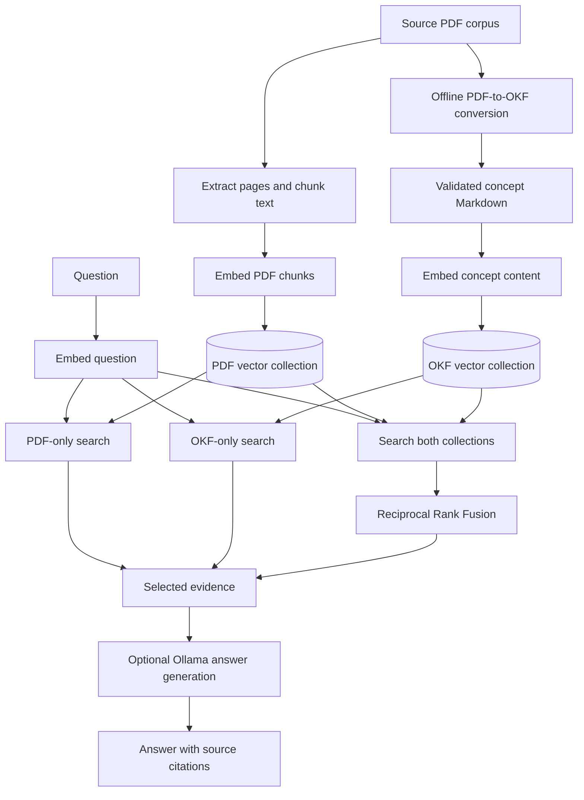
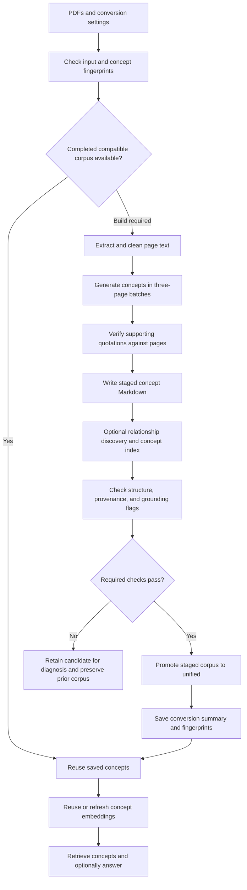
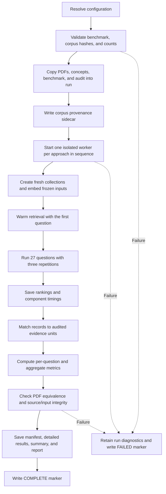

# Knowledge Engines Comparison

## Project overview, architecture, and evaluation report

| Document field | Value |
|---|---|
| Report date | 13 November 2026 |
| Project | `knowledge-engines-comparisons` |
| Evaluated revision | `4ddd8cf19df4c8c2a8011ec6f6ce01076a999339` |
| Experiment | `20261112T124350Z_a62c8ce0`, started 12 November 2026 at 18:13:50 IST |
| Corpus version | `7f8cf21346fb-4b7fd5f947d0` |
| Metric version | 2 |
| Evidence basis | Existing application code, benchmark annotations, frozen inputs, and saved experiment artifacts |
| Assessment status | Completed retrieval pilot with outstanding corpus and research validation work |

## 1. Executive assessment

The project compares retrieval over original PDF passages, generated OKF concept documents, and a combination of both. It implements standalone question answering for each approach and a reproducible retrieval evaluation workflow.

The completed experiment evaluated 27 questions against all three approaches. PDF-only retrieval achieved the highest evidence recall at K = 8, covering 98.89% of required evidence on a per-question average and returning complete evidence for 26 of 27 questions. OKF-only retrieval achieved the highest MRR@8 at 0.9321 and the smallest index at 1.33 MiB. Its complete-evidence success was 10 of 27 questions. Hybrid retrieval improved recall over PDF-only at K = 3 and K = 5, while its recall at K = 8 was lower than PDF-only.

Two mechanisms explain much of this result. The audited concepts lack full support for 55 of the benchmark's 152 evidence units. Hybrid fusion allocates its eight final records equally between PDFs and concepts in every saved question, which can exclude supporting PDF passages ranked below fourth place.

These findings describe the recorded corpus, annotations, retrieval settings, and local execution environment. The project has a working comparison and preserved evidence for its results. Full concept-content review, independent evaluation questions, and uncertainty analysis remain outstanding.

The numerical results and experiment identity are preserved in the saved summary and manifest. [Summary](evaluation-framework/results/20261112T124350Z_a62c8ce0/summary.json), [manifest](evaluation-framework/results/20261112T124350Z_a62c8ce0/manifest.json).

## 2. Objective and functional scope

The engineering objective is to measure how the representation of textbook knowledge affects retrieval coverage, ranking, query latency, indexing work, and storage.

| Approach | Retrieved representation | Application | Saved evaluation arm |
|---|---|---|---|
| PDF-only | Passages extracted and chunked from source PDFs | `pdf-rag-baseline` | `pdf_rag_baseline` |
| OKF-only | Generated concept titles, descriptions, tags, and knowledge content | `pdf-to-okf-auto` | `okf_only_ablation` |
| Hybrid | PDF chunks and OKF concepts combined through Reciprocal Rank Fusion | `hybrid-rag` | `hybrid_rag` |

The three applications support retrieval-augmented answer generation through Ollama. Their evidence representations differ. The OKF application answers from saved concepts and retains PDF references as provenance. Related-concept links are stored as metadata and navigation links. Retrieval currently uses vector similarity and rank fusion, with graph traversal outside the implemented retrieval path.

The recorded experiment measures retrieval quality and performance. Generated-answer correctness, faithfulness, citation entailment, conversion runtime, and generation latency remain unmeasured in this run. [PDF pipeline](pdf-rag-baseline/src/pipeline.py), [OKF pipeline](pdf-to-okf-auto/src/pipeline.py), [hybrid pipeline](hybrid-rag/src/pipeline.py), [experiment worker](evaluation-framework/adapters/experiment_worker.py).

## 3. Current project structure

```text
knowledge-engines-comparisons/
|-- pdf-rag-baseline/
|   |-- src/                  PDF ingestion, shared chunking wrapper, embedding,
|   |                         vector storage, generation, and pipeline coordination
|   |-- scripts/              Interactive pipeline and diagnostic utilities
|   |-- tests/                Component and integration tests
|   |-- data/input/sample/    Local source PDF copy used by standalone scripts
|   `-- chroma_db/            Standalone PDF index
|-- pdf-to-okf-auto/
|   |-- src/                  Conversion, validation, concept loading, embeddings,
|   |                         concept storage, and answer generation
|   |-- scripts/              Full conversion pipeline, saved-concept QA, and audits
|   |-- tests/                Conversion, provenance, reuse, QA, and relationship tests
|   `-- data/
|       |-- input/sample/     Canonical source corpus
|       |-- chroma_db/        Standalone concept index
|       `-- output/ollama_full_run/unified/
|                             Canonical 103-concept corpus and index.md
|-- hybrid-rag/
|   |-- src/                  PDF/OKF loaders, embeddings, separate collections,
|   |                         rank fusion, generation, and pipeline coordination
|   |-- scripts/              Embedding, retrieval, and QA smoke-test utilities
|   |-- tests/                Components, source isolation, fusion, and pipeline tests
|   `-- data/                 Standalone indexes and local input copies
|-- retrieval_shared/
|   |-- pdf_loader.py         Common PDF extraction for controlled experiments
|   `-- pdf_chunking.py       Deterministic chunking and page provenance
`-- evaluation-framework/
    |-- adapters/             Isolated application workers and experiment worker
    |-- benchmark/            Questions, evidence labels, audit, and annotation rules
    |-- src/common/           Configuration and subprocess protocol
    |-- src/evaluation/       Validation, orchestration, matching, and scoring
    |-- src/metrics/          Retrieval metric implementations
    |-- scripts/             Benchmark validation and evidence diagnostics
    |-- tests/               Matcher, metrics, benchmark, and orchestration tests
    |-- config.yaml           Dataset, environment, model, chunking, and K settings
    `-- results/              Completed experiment and directory placeholder
```

Each application and the evaluator have their own Python environment and dependency manifest. The shared preprocessing package lives at repository level. The evaluator's `data/` directory is currently empty. The recommended experiment creates indexes inside its run directory. The older `runner.py` retains support for separately built indexes configured under `data/indexes/`.

The current configuration selects the converter's source PDFs and concept corpus as authoritative inputs. Hybrid's checked-in smoke scripts also reference these locations. Standalone baseline scripts use the baseline's local PDF copy. [Configuration](evaluation-framework/config.yaml), [baseline entry point](pdf-rag-baseline/scripts/run_pipeline.py), [hybrid entry point](hybrid-rag/scripts/smoke_test_pipeline.py).

## 4. System architecture and data flow

### 4.1 Retrieval and answering



PDF records preserve text, deterministic identifiers, document identity, and physical page numbers. OKF records preserve concept identity, title, description, tags, source references, quotations when available, and relationship metadata. Both representations use FastEmbed embeddings and persistent Chroma collections with cosine distance.

For the controlled experiment, both PDF paths use the same loader, chunker, and explicit embedding configuration. The runner compares their PDF record counts and fingerprints covering identifiers, text, and page provenance. Standalone applications retain their own loader entry points. [Shared loader](retrieval_shared/pdf_loader.py), [shared chunker](retrieval_shared/pdf_chunking.py), [worker](evaluation-framework/adapters/experiment_worker.py).

### 4.2 PDF-to-OKF conversion and reuse



The conversion CLI coordinates extraction, cleaning, generation, staging, validation, and optional QA. Supporting quotation checks confirm text occurrence on cited pages. The semantic-quality module uses word overlap and duplicate similarity as review signals. Human review remains necessary to assess every generated claim. Older concept bundles can be selected through explicit reuse. [Conversion CLI](pdf-to-okf-auto/scripts/run_pipeline.py), [generator](pdf-to-okf-auto/src/generation/okf_generator.py), [provenance validator](pdf-to-okf-auto/src/validation/provenance_validator.py), [quality checks](pdf-to-okf-auto/src/validation/semantic_quality.py).

The standalone OKF pipeline hashes saved concept files before indexing. Unchanged files allow reuse of embeddings. Changed files trigger index refresh, including removal of obsolete concepts. Answer generation loads lazily when a question requires it. Citation checks validate evidence identifiers and reject uncited answers, while claim-by-claim entailment remains a separate review concern. [OKF pipeline](pdf-to-okf-auto/src/pipeline.py), [concept store](pdf-to-okf-auto/src/retrieval/vector_store.py), [answer generator](pdf-to-okf-auto/src/generation/answer_generator.py).

### 4.3 Controlled experiment



Each worker stays alive while building its index and processing the question batch. JSON requests and responses connect the evaluator to the selected project environment. Isolation prevents the applications' identically named `src` packages from colliding.

The experiment directly reuses the projects' embedders, concept loaders, and hybrid ranker, alongside shared PDF preprocessing and fresh Chroma collections. It bypasses standalone answer-generation orchestration. The saved measurements therefore describe this controlled retrieval path. [Orchestrator](evaluation-framework/src/evaluation/experiment.py), [worker protocol](evaluation-framework/src/common/worker.py), [experiment worker](evaluation-framework/adapters/experiment_worker.py).

## 5. Evaluation design and controls

| Setting | Recorded value |
|---|---|
| PDF corpus | 9 PDFs, 100 physical pages |
| Concept corpus | 103 concepts plus a navigation index |
| Benchmark | 27 questions and 152 evidence units |
| Question distribution | 9 factual, 9 conceptual, 9 labelled multi-hop |
| Benchmark source coverage | Seven chapter PDFs |
| Cross-document questions | 0 |
| Unanswerable questions | 0 |
| Embedding model | `BAAI/bge-small-en-v1.5` |
| Vector dimensions and distance | 384, cosine |
| PDF chunk settings | Target 275 words, overlap 50 words, with paragraph/heading boundaries |
| Scoring cutoffs | K = 1, 3, 5, 8 |
| Candidate depth | 8 for single-source retrieval, 8 per collection for hybrid |
| Hybrid fusion | Equal-weight RRF, constant 60 |
| Repetitions | 3 per question and approach |
| Timing samples | 81 per approach, 243 total |
| Quality-scored records | 81 question-approach pairs using first-repetition results |

All 27 questions in each approach retained identical record-ID rankings across the three saved repetitions. Timing repetitions measure variation in repeated local queries. The question set remains the same across repetitions.

The manifest records Python 3.12.10, ChromaDB 1.5.9, and FastEmbed 0.9.1 in each worker. Other dependencies can differ between environments, including the PDF reader version in the converter environment. The controlled PDF paths both use the baseline/hybrid environments, which record pypdf 6.21.4. The shared PDF chunk fingerprints are identical.

Benchmark labels, frozen source files, effective configuration, and environment versions are preserved with the run. [Frozen benchmark](evaluation-framework/results/20261112T124350Z_a62c8ce0/inputs/questions.json), [manifest](evaluation-framework/results/20261112T124350Z_a62c8ce0/manifest.json).

### 5.1 Evidence matching

PDF evidence credit requires the correct document, all cited physical pages, and every required source excerpt in order within one retrieved record. Concept evidence credit requires an audited full-support concept ID and the complete annotated supporting excerpts in its retrieved text. Formatting normalization preserves meaningful words and numeric distinctions.

Multiple independently sufficient anchors represent alternatives. Independent requirements have separate evidence units, and coverage can accumulate across records. Partial support receives zero full-evidence credit. Support that requires joining fragments into one fact remains outside the implemented matching policy. These choices make scoring conservative and can reject semantically sufficient paraphrases. [Annotation rules](evaluation-framework/benchmark/README.md), [matcher](evaluation-framework/src/evaluation/evidence_matcher.py), [normalization](evaluation-framework/src/evaluation/text_matching.py).

### 5.2 Metric definitions

| Metric | Definition and interpretation |
|---|---|
| Precision@K | Returned records matching at least one evidence unit, divided by K. Repeated relevant records count as relevant. |
| Evidence Recall@K | Distinct matched evidence units divided by the question's required units. Repetition adds no coverage. |
| Complete Success@K | One when every required unit is retrieved, otherwise zero. Aggregate values are the fraction of complete questions. |
| MRR@8 | Mean reciprocal rank of the first supporting record within the eight collected positions. |
| Duplicate evidence rate@K | Repeated evidence hits divided by all evidence hits, calculated per question and then averaged. |
| nDCG and MAP | Excluded and serialized as `null` under metric version 2. |

Aggregate quality metrics are macro-averages that weight each question equally. Recall averages therefore differ from a single ratio over all 152 evidence units. Relevance grades are retained in annotations, while the reported recall and precision use binary evidence matches. [Metrics](evaluation-framework/src/metrics/retrieval_metrics.py), [aggregation](evaluation-framework/src/evaluation/evaluate.py).

## 6. Recorded results

### 6.1 Overall retrieval quality at K = 8

| Measure | PDF-only | OKF-only | Hybrid |
|---|---:|---:|---:|
| Evidence recall | 98.89% | 68.07% | 96.34% |
| Complete evidence success | 96.30% | 37.04% | 88.89% |
| Complete questions | 26/27 | 10/27 | 24/27 |
| Relevant-record precision | 19.44% | 15.74% | 33.33% |
| MRR@8 | 0.8707 | 0.9321 | 0.9074 |
| Duplicate evidence rate | 5.64% | 4.48% | 40.97% |

Higher record precision can coexist with repeated evidence. A concept and a PDF passage may both support the same fact, improving relevant-record precision while adding little new coverage. [Quality summary](evaluation-framework/results/20261112T124350Z_a62c8ce0/summary.json).

### 6.2 Evidence recall by retrieval depth

| K | PDF-only | OKF-only | Hybrid |
|---|---:|---:|---:|
| 1 | 64.76% | 59.51% | 64.76% |
| 3 | 86.37% | 66.83% | 89.85% |
| 5 | 93.61% | 68.07% | 94.74% |
| 8 | 98.89% | 68.07% | 96.34% |

Hybrid leads PDF-only by 3.48 percentage points at K = 3 and 1.12 points at K = 5. PDF-only leads hybrid by 2.55 points at K = 8. OKF coverage reaches its observed maximum by K = 5. [Depth-specific metrics](evaluation-framework/results/20261112T124350Z_a62c8ce0/summary.json).

### 6.3 Results by question type at K = 8

| Question type | PDF recall | OKF recall | Hybrid recall | Complete questions, PDF / OKF / hybrid |
|---|---:|---:|---:|---|
| Factual | 100.00% | 80.74% | 100.00% | 9/9, 5/9, 9/9 |
| Conceptual | 100.00% | 66.25% | 94.95% | 9/9, 3/9, 8/9 |
| Multi-hop labelled | 96.67% | 57.21% | 94.07% | 8/9, 2/9, 7/9 |

The multi-hop labels cover within-document evidence combinations in this benchmark. Cross-document retrieval performance remains unmeasured. [Question-type breakdown](evaluation-framework/results/20261112T124350Z_a62c8ce0/summary.json).

### 6.4 Performance and storage

| Measure | PDF-only | OKF-only | Hybrid |
|---|---:|---:|---:|
| Indexed records | 198 chunks | 103 concepts | 198 chunks + 103 concepts |
| Worker initialization | 2.61 s | 2.34 s | 1.87 s |
| Index build | 32.96 s | 13.85 s | 47.21 s |
| Recorded index storage | 2.99 MiB | 1.33 MiB | 4.46 MiB |
| Median query latency | 10.57 ms | 13.68 ms | 12.20 ms |
| p95 query latency | 14.37 ms | 23.88 ms | 16.30 ms |
| Median embedding stage | 8.54 ms | 11.19 ms | 8.39 ms |
| Median search stage | 1.89 ms | 2.56 ms | 3.43 ms |
| Median fusion/post-search stage | 0.0016 ms | 0.0017 ms | 0.1868 ms |

Index storage uses the manifest's captured database byte counts, divided by 1,048,576. Query totals measure embedding, vector search, and fusion/post-search work. Initialization, index building, warmup, and response serialization are excluded. The single-source fusion-stage field measures the small post-search processing interval. Stage medians need not sum to the median total.

Build times include preprocessing, embedding, and database writes. OKF conversion happened earlier and its historical runtime is unavailable. The smaller OKF index built faster in this run, while its warm query latency was higher. Query embedding time accounts for much of that difference. Sequential worker order, local caching, and host load limit broader latency conclusions. Hardware details and concurrent-load measurements were not captured. [Timing summary](evaluation-framework/results/20261112T124350Z_a62c8ce0/summary.json), [build and storage measurements](evaluation-framework/results/20261112T124350Z_a62c8ce0/manifest.json).

## 7. Findings and failure analysis

### 7.1 Concept coverage limits OKF recall

The benchmark has 97 evidence units with at least one fully supporting concept and 55 without one. There are 104 full-support concept annotations because multiple concepts can support the same unit. Another 24 annotations record partial support.

Under those labels, the maximum macro-averaged recall obtainable by retrieving every fully supporting concept is 68.44%. This value is calculated by dividing fully supported units by total units within each question, then averaging over the 27 questions. The achieved 68.07% is only 0.37 percentage points below that bound. OKF retrieves support for 96 of the 97 eligible units at K = 8. Exactly ten questions have full concept support for every required unit, and all ten receive complete-evidence credit.

The evidence supports the inference that missing concept content is the dominant constraint on this corpus's OKF recall. Ranking changes alone have limited scope to improve full-benchmark coverage under the current labels. This bound depends on the completeness of the editorial support mappings. [Frozen annotations](evaluation-framework/results/20261112T124350Z_a62c8ce0/inputs/questions.json), [scored evidence matches](evaluation-framework/results/20261112T124350Z_a62c8ce0/detailed.json).

### 7.2 Early support and complete coverage measure different outcomes

OKF returns a supporting first-ranked result for 24 of 27 questions, compared with 22 for PDF-only and 22 for hybrid. This produces its higher MRR. Required details can still be absent from its concept corpus, which accounts for the much lower complete-evidence success.

For `JESS105-Q07`, OKF misses the Bailadila export destination/port fact and the Kudremukh slurry-pipeline fact. Both evidence units have empty full-support concept mappings. PDF-only and hybrid retrieve all required evidence for that question. [Detailed results](evaluation-framework/results/20261112T124350Z_a62c8ce0/detailed.json), [question and evidence text](evaluation-framework/results/20261112T124350Z_a62c8ce0/inputs/questions.json).

### 7.3 Fusion changes the available PDF depth

RRF uses `score(record) = sum(1 / (60 + source_rank))` over matching record IDs. PDF chunk hashes and concept IDs normally identify different records. Equal source ranks therefore tie. The implementation processes PDFs first and uses stable sorting, so tied PDF records precede concepts.

Every saved hybrid top-eight list contains four PDF chunks and four concepts. For `JESS103-Q02`, covering environmental effects of dams, the baseline's supporting PDF chunks appear at ranks five and six. Hybrid's final eight omit those chunks, and concept evidence covers only six of eleven units. PDF-only recall is 100%, while hybrid recall is 54.55% for that question.

For `JESS104-Q08`, the baseline's sixth-ranked passage supplies the inheritance and alternative-livelihood facts. Hybrid excludes that PDF depth and achieves 66.67% recall, compared with 100% for PDF-only. These examples connect the observed loss directly to the fusion cutoff. [RRF implementation](hybrid-rag/src/fusion/ranker.py), [saved rankings](evaluation-framework/results/20261112T124350Z_a62c8ce0/raw.json), [per-rank evidence matches](evaluation-framework/results/20261112T124350Z_a62c8ce0/detailed.json).

### 7.4 Concepts can recover evidence that PDF ranking misses

For `JESS104-Q07`, covering plantation agriculture, labour, and processing, PDF-only retrieves seven of ten units. Hybrid retrieves eight by adding concept support for the labour-intensive nature of tea cultivation. Both still miss the required labour characteristics and processing-within-the-garden fact.

This example demonstrates the complementary value of concept retrieval even though the overall hybrid result at K = 8 trails PDF-only. Its usefulness varies with the question and final context depth. [Detailed evidence coverage](evaluation-framework/results/20261112T124350Z_a62c8ce0/detailed.json), [benchmark facts](evaluation-framework/results/20261112T124350Z_a62c8ce0/inputs/questions.json).

## 8. Architectural changes implemented

| Area | Earlier design or failure mode | Current implementation and effect |
|---|---|---|
| Standalone OKF QA | Concept retrieval depended on the hybrid application's OKF path | The converter owns concept loading, embedding, storage, retrieval, and answer generation. The evaluator's OKF arm uses its environment. |
| Conversion reuse | Repeated question commands could regenerate concepts | Input/settings/concept fingerprints and explicit reuse options support querying completed bundles. |
| Concept index lifecycle | Changed concept sets could leave obsolete records | The standalone concept store refreshes records and removes obsolete IDs, with model compatibility metadata and corpus fingerprints. |
| PDF preprocessing | Baseline and hybrid used different chunking implementations | Shared deterministic chunking plus a common experiment loader provides equivalent PDF records. |
| Ground truth | Topic-level mappings and multi-fact labels could overstate coverage | Audited evidence units distinguish full and partial concept support and preserve missing facts in denominators. |
| Evidence matching | Document/page overlap or an ID could receive credit | Retrieved text must contain complete annotated supporting excerpts with valid identity/provenance. |
| Metrics | Duplicate handling and record/evidence granularity distorted interpretation | Relevant-record precision, distinct-evidence recall, complete success, bounded MRR, and redundancy are explicit. nDCG/MAP are excluded. |
| Experiment lifecycle | Collection relied on previously built indexes | A single workflow freezes inputs, builds fresh indexes, checks equivalence, retrieves, scores, and reports the selected question set. |
| Timing | Per-question subprocess overhead entered retrieval timing | Each approach uses one batch worker, separate initialization/build/warmup measurements, and internal query timings. |
| Reproducibility | Reports had limited ties to exact corpus and code versions | Manifests include revision, source hashes, dependency versions, settings, question IDs, corpus hashes, counts, and storage. |

These changes are implemented in the current pipelines, evaluation modules, and shared preprocessing. Legacy adapters and `runner.py` remain available. Future architectural options, such as fact-aware fusion, should be evaluated as additional experiments with their own frozen settings. [OKF reuse](pdf-to-okf-auto/src/pipeline.py), [conversion reuse](pdf-to-okf-auto/scripts/run_pipeline.py), [shared chunking](retrieval_shared/pdf_chunking.py), [orchestration](evaluation-framework/src/evaluation/experiment.py), [matcher](evaluation-framework/src/evaluation/evidence_matcher.py), [metrics](evaluation-framework/src/metrics/retrieval_metrics.py).

## 9. Output storage and traceability

```text
evaluation-framework/results/20261112T124350Z_a62c8ce0/
|-- COMPLETE.json              Successful run identifier
|-- manifest.json              Code, configuration, corpus, dependencies, counts, costs
|-- raw.json                   Retrieved text, metadata, rankings, and repeat timings
|-- detailed.json              Evidence matches and scores per question and approach
|-- summary.json               Overall/type metrics and latency distributions
|-- report.md                  Compact comparison table
|-- inputs/
|   |-- pdf/                  Frozen original documents
|   |-- okf/                  Frozen concept Markdown and navigation index
|   |-- questions.json        Exact question/evidence annotations
|   |-- evidence_audit.json   Source and benchmark hashes plus mapping audit
|   `-- corpus_validation.json
|                             Versioned benchmark-support provenance sidecar
`-- indexes/
    |-- baseline/             experiment_pdf collection
    |-- okf/                  experiment_okf collection
    `-- hybrid/               experiment_pdf and experiment_okf collections
```

The provenance sidecar stays outside the embedded concept Markdown. Benchmark-support annotations therefore remain separate from retrieval content. `corpus_validation.json` records the review status as `benchmark_evidence_reviewed_not_full_content`.

Chroma stores collection records and metadata in `chroma.sqlite3`, together with UUID-named HNSW binary index directories. PDF records contain text, IDs, filename, pages, and vectors. Concept records add title, description, tags, source references, and optional evidence/relationship metadata. List-valued metadata is commonly JSON-serialized into strings.

Standalone indexes live in each application's configured database directory. CLI answers and citations are printed to the terminal. The canonical generated concepts remain under the converter's `data/output/ollama_full_run/unified/`. That older bundle currently has no preserved `reports/pipeline_summary.json`. The newer conversion workflow writes such a report on completed conversion attempts. [Conversion output implementation](pdf-to-okf-auto/scripts/run_pipeline.py), [concept metadata](pdf-to-okf-auto/src/embeddings/embedder.py), [PDF metadata](pdf-rag-baseline/src/embeddings/embedder.py).

Generated results and indexes are ignored by Git. The experiment folder needs separate preservation alongside the source revision for a complete reproducibility package. Historical standalone indexes can have different counts and settings from the run-owned indexes. [Ignore rules](evaluation-framework/.gitignore), [experiment manifest](evaluation-framework/results/20261112T124350Z_a62c8ce0/manifest.json).

## 10. Validation evidence and limitations

The report review confirmed that the current Python source hashes match the experiment manifest. Recalculation from the existing frozen questions and raw results reproduced all 81 detailed score records, aggregate metrics, and latency summaries. Frozen input fingerprints matched their audit, and the benchmark validation checked all 152 evidence units against source excerpts and concept support. The application test suites cover ingestion, generation, citation handling, storage, reuse, matching, scoring, and experiment orchestration. This report's results come from the preserved experiment.

| Limitation | Effect on interpretation |
|---|---|
| Partial corpus review | Benchmark-support annotations are audited, while semantic correctness of every concept claim remains unreviewed. Known contamination is recorded in the corpus validation sidecar. |
| Small pilot benchmark | Twenty-seven questions provide descriptive evidence over this corpus. Independent held-out performance and paired confidence intervals remain outstanding. |
| Seven of nine PDFs represented by questions | Appendix and preliminary-material retrieval quality has no direct question-level evaluation. |
| Conservative lexical scoring | Paraphrases and support spread across several records can receive zero full-evidence credit. Annotation completeness affects measured recall. |
| Different record granularity | One PDF chunk may support many units. Concept records can be shorter. Record precision and fixed-K context have representation-dependent meanings. |
| Hybrid candidate budget | Hybrid searches 16 candidates to return eight, while each single-source arm searches eight. Search work and context allocation differ. |
| Local timing protocol | One sequential experiment, one warmup question, fixed arm order, and repeated queries limit conclusions about cold starts, throughput, and host-independent latency. |
| Historical conversion cost unavailable | Index-build savings omit the earlier PDF-to-OKF generation cost. |
| Answer evaluation outstanding | Retrieval evidence supports analysis of coverage and ranking. Generated-answer quality remains a separate deliverable. |
| Deployment concerns unassessed | Authentication, hosted-service operations, concurrency, and production load were outside this review. |

The run's validation report explicitly records the corpus review boundary. [Corpus validation](evaluation-framework/results/20261112T124350Z_a62c8ce0/inputs/corpus_validation.json), [benchmark rules](evaluation-framework/benchmark/README.md), [experiment protocol](evaluation-framework/EXPERIMENTS.md).

## 11. Recommended completion work

| Priority | Action | Completion evidence |
|---|---|---|
| High | Review and correct every concept claim, recording source quotations and conversion provenance | A versioned reviewed corpus, validation report, and refreshed evidence mappings |
| High | Investigate the 55 units lacking full concept support | A documented conversion-loss analysis with corrected content where appropriate |
| High | Add held-out questions and paired uncertainty estimates | A frozen independent benchmark and confidence intervals for approach differences |
| Medium | Compare fusion alternatives and final evidence budgets | Separate reproducible runs showing coverage, redundancy, and latency tradeoffs |
| Medium | Document appendix/preliminary-material scope and add cross-document questions where relevant | Explicit corpus inclusion rules and appropriately labelled evaluation questions |
| Medium | Measure fresh conversion cost and strengthen latency experiments | Recorded conversion runtime, host specifications, varied execution order, and repeated runs |
| Medium | Align older README planning sections with implemented metric version 2 | Documentation consistent with the actual retrieval-only experiment |
| Optional | Evaluate generated-answer quality | Human or defined automated correctness, faithfulness, citation, and abstention assessments |

For the recorded pilot, PDF-only provides the strongest complete-evidence coverage at K = 8. OKF provides compact storage and early topical support with a substantial coverage constraint from the current concept corpus. Hybrid provides useful gains at smaller K and some complementary evidence, with an observed depth-allocation and redundancy tradeoff. Subsequent conclusions should identify the exact corpus version, benchmark, candidate depths, and fusion policy used.
